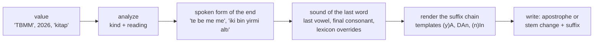

# turkish-inflect

Grammatically correct Turkish suffixes for dynamic values in UI strings and i18n.

[](https://github.com/aozmekik/turkish-inflect/actions/workflows/ci.yml)
[](LICENSE)

```ts
format('{name:dative} bir mesaj gönderildi', { name });
// Ayşe'ye · Ahmet'e · İstanbul'a · 2026'ya · TBMM'ye · NATO'ya · kitaba
```

> **Status:** early, v0.1.0. The API may change before 1.0. Not yet published to npm.

## Why

In Turkish the case ending is part of the word and depends on how that word sounds: its last
vowel (vowel harmony), whether it ends in a vowel (buffer letters), whether its last sound is
voiceless (d/t), and for names, numbers and abbreviations it is separated by an apostrophe. A
template such as `"{name}'e gönderildi"` is therefore wrong for most values (Ayşe'e, İstanbul'e,
2026'e), and the usual workaround ("{name} adlı kullanıcıya") makes UI copy stilted.

Numbers and abbreviations are inflected by how they are _read aloud_: 2026 is "iki bin yirmi
altı", so 2026'ya; TBMM is "te be me me", so TBMM'ye; 40 is "kırk", so 40'ta. A table keyed on
the last character cannot get these right. This library reads the value the way a Turkish
speaker would and applies the rules of TDK's spelling guide, the _Yazım Kılavuzu_.

## Features

- Case suffixes (accusative, dative, locative, ablative, genitive, instrumental and the separate
  `ile`), plural, possessives for every person, the adjectival `-ki` (evdeki, yarınki, bugünkü),
  the ordinal suffix (15'inci), the copula `-dır` and the question particle `mı`; chains such as
  evdekilerden.
- Vowel harmony, buffer letters and d/t assimilation; softening, vowel drop and consonant
  doubling for common nouns (kitabı, ağzı, hakkı); proper nouns are never softened in writing
  (Tokat'ı).
- Apostrophes where TDK writes them: proper nouns, numbers, abbreviations and letters; none
  before the plural of a name (Ahmetler) or after a dotted abbreviation (Alm.dan).
- Numbers read aloud: integers up to 10^21 − 1, decimals, negatives, percentages, fractions and
  clock times, plus `numberToWords` and `ordinal`.
- Abbreviations read letter by letter with Turkish letter names, known acronyms as words, and
  lower-case symbols as their word (kg'dan).
- A curated lexicon of 215 words (palatal loanwords, softening exceptions, vowel drop, doubling),
  cross-checked against TDK's dictionary, extensible per application.
- `format` placeholders, a `tr` tagged template, and i18next and FormatJS integration examples.
- Turkish casing (`toUpper`, `toLower`, `capitalize`) without relying on ICU data.
- Zero runtime dependencies, ESM and CommonJS, strict TypeScript types, 8.70 KiB minified and
  gzipped.

## Install

Not yet published to npm. Install from GitHub (the `prepare` script builds the package):

```sh
npm install github:aozmekik/turkish-inflect
```

Requires Node.js 22 or newer. The library uses no Node.js APIs, but CI only tests it on Node.

## Quick start

```ts
import { format, inflect, tr } from 'turkish-inflect';

inflect('Ayşe', 'dative'); // "Ayşe'ye"
inflect('kitap', 'accusative'); // "kitabı"
inflect(2026, 'locative'); // "2026'da"
inflect('İzmir', ['locative', 'ki']); // "İzmir'deki"

format('{city:ablative} {name:dative} paket geldi', { city: 'Bolu', name: 'Ahmet' });
// "Bolu'dan Ahmet'e paket geldi"

const name = 'Ayşe';
tr`${name}'e mesaj gönderildi`; // "Ayşe'ye mesaj gönderildi"
```

## Usage

### Suffixes

`inflect(value, suffix | suffix[], options?)` takes one suffix or a chain in the order they
attach (ordinal, plural, possessive, case, ki, plural, case, copula, question).

| Suffix                                                                                          | Common noun         | Proper noun              | Number         |
| ----------------------------------------------------------------------------------------------- | ------------------- | ------------------------ | -------------- |
| `accusative`                                                                                    | kitabı              | Ayşe'yi                  | 3'ü            |
| `dative`                                                                                        | kitaba              | Ayşe'ye                  | 6'ya           |
| `locative`                                                                                      | kitapta             | Ahmet'te                 | 40'ta          |
| `ablative`                                                                                      | kitaptan            | Ankara'dan               | 100'den        |
| `genitive`                                                                                      | kitabın             | Ayşe'nin                 | 2'nin          |
| `instrumental`                                                                                  | kitapla             | Ayşe'yle                 | 10'la          |
| `ile`                                                                                           | kitap ile           | Ayşe ile                 | 5 ile          |
| `plural`                                                                                        | kitaplar            | Ahmetler                 | 1990'lar       |
| `possessive` (3rd sg.)                                                                          | kitabı              | Ankara'sı                | 2'si           |
| `possessive1sg` `possessive2sg` `possessive3sg` `possessive1pl` `possessive2pl` `possessive3pl` | kitabım … kitapları | Atatürk'üm               |                |
| `ki`                                                                                            | yarınki, bugünkü    | use `['locative', 'ki']` | use a chain    |
| `ordinal`                                                                                       |                     |                          | 15'inci, 2'nci |
| `copula`                                                                                        | kitaptır            | Ankara'dır               | 6'dır          |
| `question`                                                                                      | kitap mı            | Ayşe mi                  | 100 mü         |

```ts
inflect('ev', ['locative', 'ki', 'plural', 'ablative']); // "evdekilerden"
inflect('hesap', ['possessive2pl', 'dative']); // "hesabınıza"
inflect('Ahmet', ['genitive', 'ki']); // "Ahmet'inki"
inflect(15, ['ordinal', 'dative']); // "15'inciye"
```

### Options

| Option         | Default | Meaning                                                                                                                                                                 |
| -------------- | ------- | ----------------------------------------------------------------------------------------------------------------------------------------------------------------------- |
| `kind`         | `auto`  | `auto`: a capitalised last word is a proper noun, all capitals an abbreviation, a final digit a number, otherwise a common noun. `proper` or `common` force the choice. |
| `abbreviation` | `auto`  | How an all-capitals word is read: known acronyms as words, others letter by letter. `letters` or `word` force one.                                                      |
| `reading`      |         | The pronunciation in Turkish spelling, for values whose spelling does not tell: `{ reading: 'şekspir' }` for Shakespeare.                                               |
| `compound`     | `false` | The value already ends in a 3rd-person possessive (Avrupa Birliği, Türk Dil Kurumu), so case suffixes take the pronominal n.                                            |
| `apostrophe`   | `'`     | The apostrophe character, e.g. `’` (U+2019) for typeset text.                                                                                                           |

```ts
inflect('Elektronik', 'locative'); // "Elektronik'te" (looks like a name)
inflect('Elektronik', 'locative', { kind: 'common' }); // "Elektronikte" (a category label)
inflect('Avrupa Birliği', 'dative', { compound: true }); // "Avrupa Birliği'ne"
inflect('Türk Dil Kurumu', 'ablative', { compound: true, kind: 'common' }); // "Türk Dil Kurumundan"
inflect('Einstein', 'dative', { reading: 'aynştayn' }); // "Einstein'a"
```

Institution and workplace names take no apostrophe in TDK's spelling (Türk Dil Kurumundan);
pass `kind: 'common'` for them.

### Numbers

Values ending in a digit always take an apostrophe, and the suffix follows the last spoken
word. Strings use Turkish notation ("1.234.567,89"); JavaScript numbers are written with a
decimal comma and no grouping, so years stay "2026".

```ts
inflect('1.000.000', 'dative'); // "1.000.000'a"  (bir milyon)
inflect(3.5, 'locative'); // "3,5'te"           (üç virgül beş)
inflect('%50', 'possessive'); // "%50'si"        (yüzde elli)
inflect('1/2', 'possessive'); // "1/2'si"        (bir bölü iki)
inflect('17.30', 'locative'); // "17.30'da"      (on yedi otuz)
inflect('iPhone 15', 'dative'); // "iPhone 15'e" (on beş)

numberToWords(2026); // "iki bin yirmi altı"
numberToWords(-3.5); // "eksi üç virgül beş"
numberToWords('5,26', { decimal: 'tam' }); // "beş tam yüzde yirmi altı"
ordinal(4); // "dördüncü"
ordinal('3.'); // "üçüncü"
```

### Abbreviations, symbols and letters

```ts
inflect('TBMM', 'dative'); // "TBMM'ye"   (te be me me)
inflect('ABD', 'ablative'); // "ABD'den"
inflect('NATO', 'dative'); // "NATO'ya"   (known acronym, read as a word)
inflect('kg', 'ablative'); // "kg'dan"    (kilogram)
inflect('Dr.', 'dative'); // "Dr.a"       (doktor; no apostrophe after a period)
inflect('z', 'dative'); // "z'ye"         (a'dan z'ye)
inflect('İSTANBUL', 'dative', { abbreviation: 'word' }); // "İSTANBUL'a"
```

Some abbreviations are conventionally read in their full form (BM as "Birleşmiş Milletler",
GB as "gigabayt"). The default follows TDK's rule for capital-letter abbreviations, the name of
the last letter; register a reading to change it (see [Custom lexicon](#custom-lexicon)).

### Templates

`format` fills `{name}` and `{name:suffix+suffix}` placeholders; `{{` and `}}` are literal
braces. A value can carry its own options.

```ts
format('{city:locative+ki} ofis', { city: 'İzmir' }); // "İzmir'deki ofis"
format('{c:locative} indirim', { c: { value: 'Elektronik', kind: 'common' } }); // "Elektronikte indirim"
```

The `tr` tagged template re-inflects whatever suffix is written right after each value, so a
template can be written for any sample value. A following question particle is adjusted too.

```ts
tr`${user}'e ${city}'dan bir paket geldi`; // user = 'Ayşe', city = 'Bolu': "Ayşe'ye Bolu'dan bir paket geldi"
tr`Toplantı ${2026}'da ${'İzmir'} mı?`; // "Toplantı 2026'da İzmir mi?"
```

### i18next and FormatJS

[`examples/i18next.ts`](examples/i18next.ts) shows a post-processor that lets translations use
`{name:dative}` next to i18next's own interpolation, and custom formatters for
`{{name, dative}}`. [`examples/formatjs.ts`](examples/formatjs.ts) wraps ICU arguments in
rich-text tags: `'<dative>{name}</dative> bir mesaj gönderildi'` with a `dative` tag function,
which also works with react-intl.

### Custom lexicon

```ts
import { createInflector } from 'turkish-inflect';

const { inflect, format, tr } = createInflector({
  lexicon: {
    readings: { iPhone: 'ayfon', Shakespeare: 'şekspir', 'C#': 'si şarp' },
    words: { mesaj: { front: true } }, // illustrative: mesaj → mesaji
  },
  defaults: { apostrophe: '’' },
});
inflect('Yeni iPhone', 'dative'); // "Yeni iPhone’a"
```

Word entries can set `front` (palatal final: saat → saati), `soften`, `dropVowel`,
`doubleConsonant` and `bufferY` (su → suyu). `DEFAULT_LEXICON` is a frozen copy of the built-in
lists.

### Casing, analysis and errors

```ts
toUpper('istanbul'); // "İSTANBUL"
toLower('IĞDIR'); // "ığdır"
capitalize('ırmak'); // "Irmak"

analyze('TBMM'); // { text: 'TBMM', kind: 'abbreviation', reading: 'te be me me', apostrophe: true }
```

Suffixes are always lower case; for all-capitals UI, apply `toUpper` to the result:
`toUpper(inflect('istanbul', 'locative', { kind: 'proper' }))` gives "İSTANBUL'DA".

Values that cannot be read correctly throw `InflectError` with a `code` (`UNREADABLE`,
`INVALID_SUFFIX_ORDER`, `UNSUPPORTED`, ...) and a message saying how to fix the input, instead
of returning a guess ([ADR 0003](docs/adr/0003-typed-errors-instead-of-guesses.md)).

## How it works



Every value is first turned into the spoken form of its end: numbers into words, capital
abbreviations into letter names, symbols and dotted abbreviations into their word, foreign
letters into Turkish approximations. One phonology then renders suffix templates written in
the archiphoneme notation of Turkish grammars (`A` = a/e, `I` = ı/i/u/ü, `D` = d/t, `(y)` = a
buffer after vowels). Only common nouns change their written stem.

Design decisions:

- [ADR 0001](docs/adr/0001-suffixes-from-the-spoken-form.md): suffixes from the spoken form, one
  phonology for every kind of value.
- [ADR 0002](docs/adr/0002-curated-lexicon-and-default-heuristics.md): a curated lexicon on top of
  default heuristics instead of a dictionary.
- [ADR 0003](docs/adr/0003-typed-errors-instead-of-guesses.md): typed errors instead of guesses.
- [ADR 0004](docs/adr/0004-tagged-template-reads-written-suffixes.md): the tagged template reads
  the suffix the author wrote.

[docs/rules.md](docs/rules.md) maps every rule to its TDK source and to the tests that cover it.

## Verification

Measured on an Apple M1 Pro (16 GB, macOS 26.6.2) with Node.js 22.22.3, TypeScript 6.0.3 and
Vitest 5.0.5.

- **Tests:** `npm test` runs 1,374 tests in 7 files. They include 1,073 hand-written
  expectations grouped by rule in [`test/corpus/`](test/corpus/), each section citing its
  source; unit tests for every public function and error code; and 9 fast-check properties: a
  proper noun is written unchanged followed by an apostrophe, common nouns never get one,
  suffix vowels agree with the stem's last vowel, the suffix after digits equals the suffix
  after the last number word, `numberToWords` round-trips through an independent parser, the
  templates agree with `inflect`, casing round-trips, and arbitrary input throws nothing but
  `InflectError`.
- **Coverage:** `npm run coverage`: 100% of statements (610/610), lines (535/535) and functions
  (83/83); 97.77% of branches (483/494). The uncovered branches are `??` fallbacks on array
  lookups that `noUncheckedIndexedAccess` requires but that cannot miss.
- **TDK dictionary:** `npm run check:tdk` compares the accusative the library produces for every
  lexicon word and every common noun of the corpus with the inflection hint of its TDK Güncel
  Türkçe Sözlük entry. Run on 2026-10-18: 333 words checked, 2 not in the dictionary,
  0 mismatches. It needs network access and is not part of CI.

## Size and benchmarks

`npm run build && npm run size` (esbuild 0.28.2 for the minified bundle):

| File                 | Raw       | gzip -9   | brotli    |
| -------------------- | --------- | --------- | --------- |
| dist/index.js (ESM)  | 39.62 KiB | 11.63 KiB | 10.42 KiB |
| dist/index.cjs (CJS) | 39.87 KiB | 11.69 KiB | 10.46 KiB |
| minified ESM bundle  | 21.71 KiB | 8.70 KiB  | 7.93 KiB  |

The published files are unminified and keep their comments; the minified bundle is what an
application bundler adds when everything is imported.

`npm run build && npm run bench` measures the built package with tinybench 6.2.2 (1 s per task
after 200 ms of warm-up), first of three runs:

| Benchmark                                        | Median throughput (ops/s) | Median latency (ns) |
| ------------------------------------------------ | ------------------------: | ------------------: |
| inflect: proper noun (Ayşe → Ayşe’ye)            |                   558,036 |               1,792 |
| inflect: common noun, softening (kitap → kitabı) |                   599,880 |               1,667 |
| inflect: number (2026 → 2026’da)                 |                   631,313 |               1,584 |
| inflect: abbreviation (TBMM → TBMM’ye)           |                   533,333 |               1,875 |
| inflect: 4-suffix chain (ev → evdekilerden)      |                   727,273 |               1,375 |
| format: one placeholder                          |                   436,300 |               2,292 |
| tr: one interpolation                            |                   479,846 |               2,084 |

Across the three runs every median stayed within 4% of the figures above. Other heavy jobs were
running on the machine at the same time (`sysctl vm.loadavg` read 68 before and 80 after, on 8
cores), so treat these as order-of-magnitude figures: a call costs a few microseconds, which does
not matter for UI text.

## Limitations

- **Unknown words use heuristics.** Softening, palatal harmony, vowel drop and doubling are
  lexical. Words outside the 215-entry lexicon follow the defaults (p, ç, k, g soften in words
  of two or more syllables; -t words and one-syllable words do not), which is wrong for unlisted
  exceptions. Add them with `createInflector({ lexicon })`.
- **Compounds are matched as whole words.** "başkent" or "anahtar kelime" are fine, but a compound
  written as one word does not inherit the exception of its last part (a hypothetical
  "çalışmasaat" would not get saat's front vowels).
- **Possessive compounds are not detected.** Names such as "Kız Kulesi" or labels such as
  "doğum günü" need `compound: true` to get the pronominal n (Kız Kulesi'ne, doğum gününe).
- **Homographs get one reading.** The lexicon lists boyun → boynu (neck), karın → karnı (belly),
  alın → alnı (forehead), sır → sırrı (secret); the other meanings would inflect differently.
- **Foreign names are read by Turkish spelling.** Silent letters and English pronunciation go
  wrong (Shakespeare → Shakespeare'nin, Einstein → Einstein'e); pass `reading` or register it.
  Word-final "y" after a consonant is read as "i" (Harry'ye).
- **All-capitals text is read as an abbreviation** (İSTANBUL'ye) unless `abbreviation: 'word'`.
- **Abbreviations with a conventional long reading** (BM, TL, GB) follow the letter rule unless
  registered.
- **Clock times win over decimals.** "3.15" is read as a time, which gives the same suffix as
  the decimal reading; Turkish decimals use a comma anyway.
- **Currency symbols are ignored when reading** (₺50 → ₺50'ye, while "elli lira" would give
  liraya); write "50 TL" if the unit should decide.
- **Out of scope:** pronouns (ben → bana), verbs, derivational suffixes (-lı, -lık, -sız, -ca),
  Roman numerals (XX'nci), `-ki` directly on names and numbers, and suffixes on ordinals written
  with a period (TDK writes 8'inci, not 8.'inci).

## Roadmap

Cut from 0.1.0 to keep it small and correct; candidates for later versions:

- derivational suffixes -lı/-li (İstanbullu, Ankaralı), -lık, -sız and the equative -ca;
- the personal copula (-(y)ım, -sın, ...) and the pronoun paradigm;
- Roman numerals;
- an opt-in heuristic for possessive compounds;
- an upper-case suffix mode for all-capitals text;
- packaged i18next and FormatJS plugins instead of examples.

## Contributing

See [CONTRIBUTING.md](CONTRIBUTING.md) for setup, the commands CI runs, and how to add a rule or
a lexicon entry with its source. The changelog is in [CHANGELOG.md](CHANGELOG.md).

## References

- Türk Dil Kurumu, [Yazım Kılavuzu](https://yazim.tdk.gov.tr/) (online edition): chapters
  _Ses, Harf ve Alfabe_ (letter names), _Sesler ve Ses Uyumları_ (vowel harmony, consonant
  harmony, softening, vowel drop, consonant doubling, the -ki suffix), _Bazı Kelime ve Eklerin
  Yazılışı_ (ile, the question particle), _Sayıların Yazılışı_, _Noktalama İşaretleri_ (the
  apostrophe) and _Kısaltmalar_; also the rule pages on
  [tdk.gov.tr](https://tdk.gov.tr/icerik/yazim-kurallari/kesme-isareti/).
- Türk Dil Kurumu, [Güncel Türkçe Sözlük](https://sozluk.gov.tr/): inflection hints of
  headwords, used to verify the lexicon.
- Aslı Göksel and Celia Kerslake, _Turkish: A Comprehensive Grammar_, Routledge, 2005: general
  background on Turkish morphophonology and the archiphoneme notation.
- [Zemberek-NLP](https://github.com/ahmetaa/zemberek-nlp) and
  [TRmorph](https://github.com/coltekin/TRmorph) are full morphological analysers for Turkish;
  this library solves the narrower generation problem for UI strings and shares no code with them.

## License

[MIT](LICENSE) © 2026 Ahmed Semih Özmekik

## Türkçe özet

turkish-inflect, arayüz metinlerindeki ve çevirilerdeki değişken değerlere doğru Türkçe ekleri
getiren, bağımlılıksız bir TypeScript kütüphanesidir. `{name}'e gönderildi` gibi bir şablon
değere göre Ayşe'ye, Ahmet'e, İstanbul'a, 2026'ya, TBMM'ye ya da kitaba olur. Kurallar TDK Yazım
Kılavuzu'na dayanır: ünlü uyumları, ünsüz benzeşmesi ve yumuşaması, ünlü düşmesi, ünsüz türemesi,
özel adlarda, sayılarda ve kısaltmalarda kesme işareti. Sayılar okunuşlarına göre (2026 → iki bin
yirmi altı → 2026'ya), kısaltmalar harf adlarına göre (TBMM → te be me me → TBMM'ye) çekimlenir;
`numberToWords`, `ordinal`, Türkçe büyük-küçük harf dönüşümü, `format` şablonları, `tr` etiketli
şablonu ile i18next ve FormatJS örnekleri de vardır. Sözlükte olmayan kelimelerde kurallar
tahmine dayanır; ayrıntılar yukarıdaki Limitations bölümündedir. Proje erken aşamadadır (v0.1.0)
ve henüz npm'de yayımlanmamıştır.

---

Built by [Ahmed Semih Özmekik](https://github.com/aozmekik) at [Fergani](https://fergani.tr).
